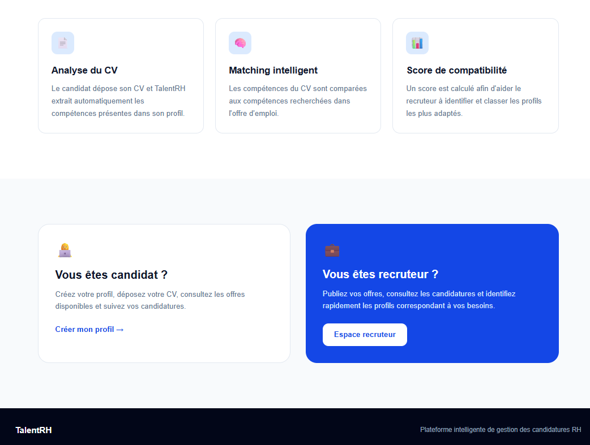
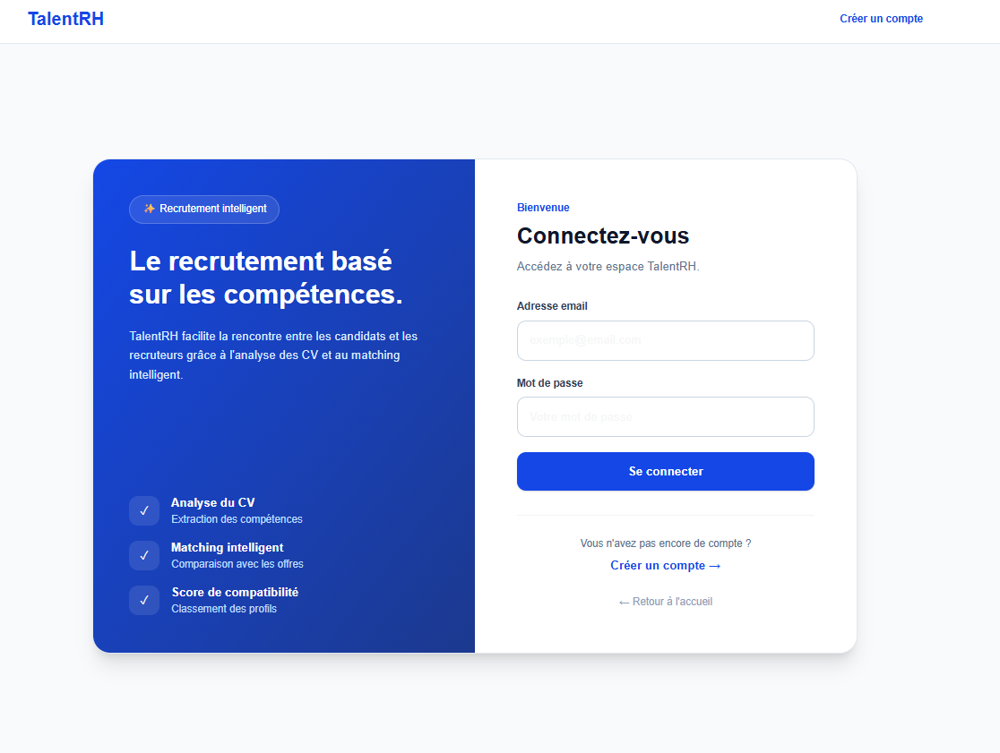
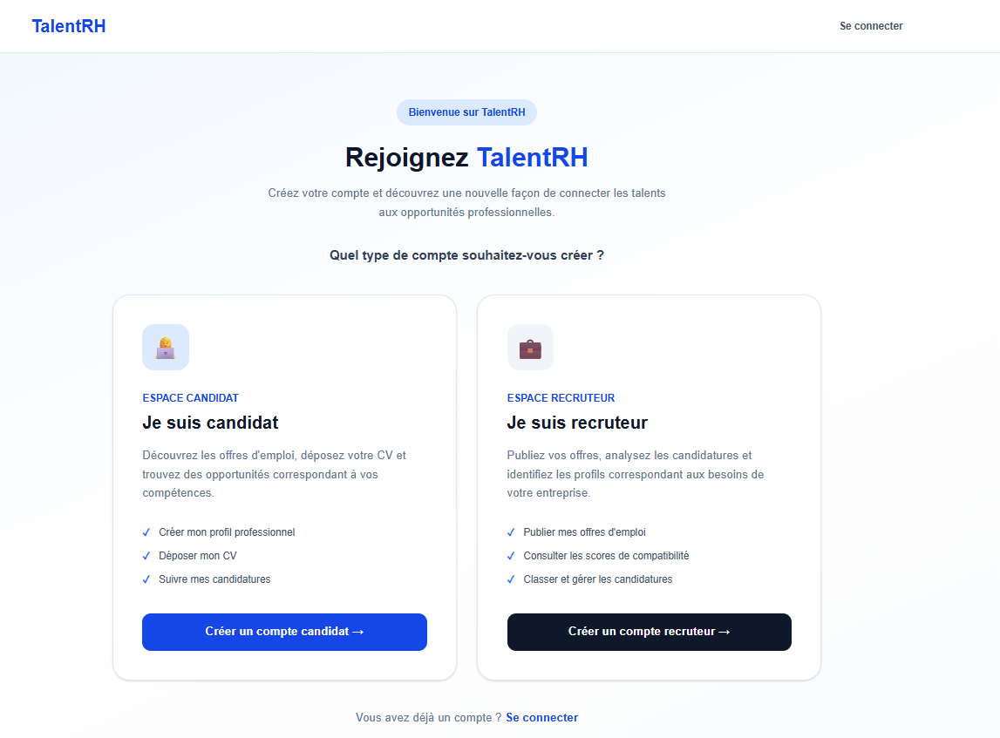
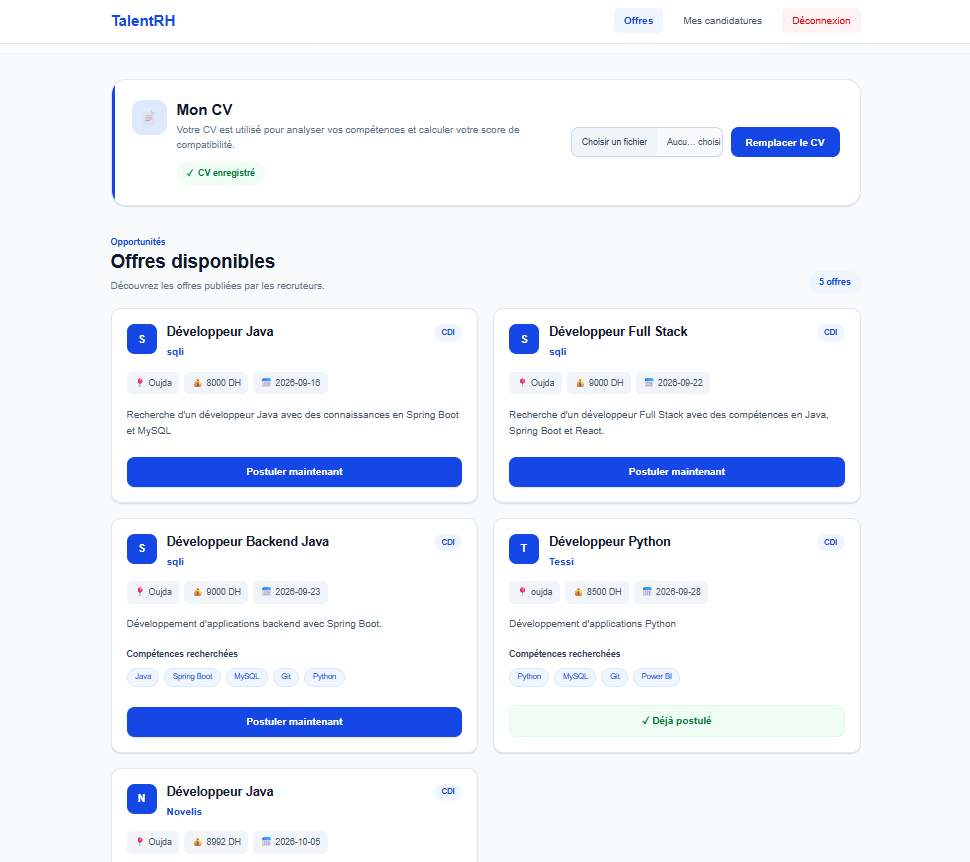
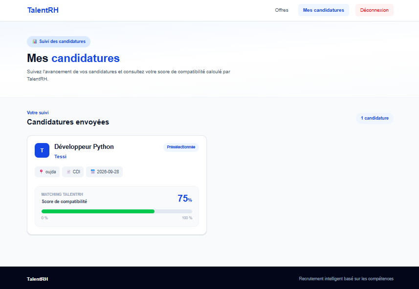
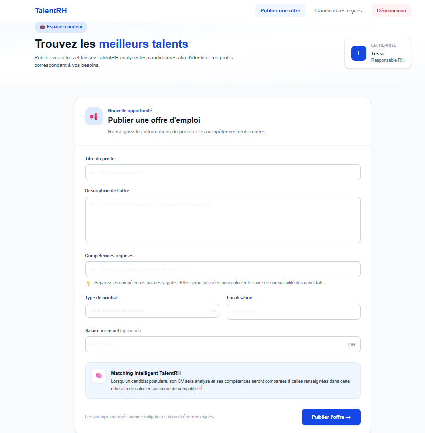
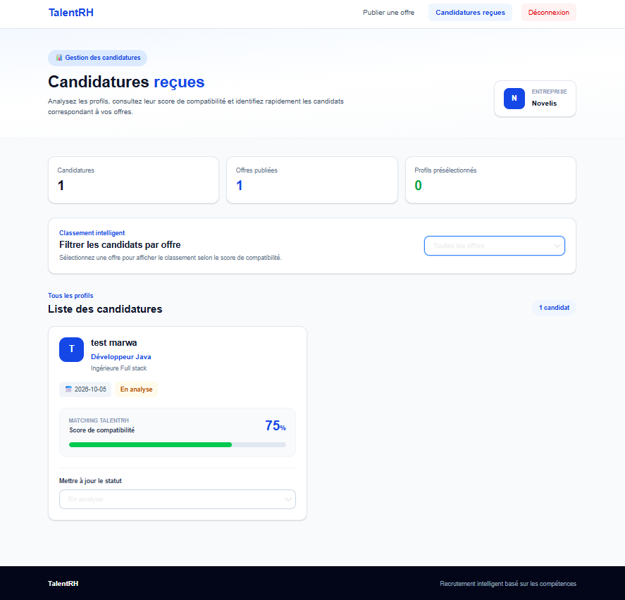

# TalentRH , AI-Powered Recruitment Platform

## About the Project
TalentRH is an intelligent recruitment management platform designed to simplify the recruitment process through artificial intelligence and Natural Language Processing (NLP).

The platform allows candidates to apply for job opportunities and recruiters to manage applications more efficiently.

## Technologies
- **Frontend:** Next.js, React, Tailwind CSS
- **Backend:** Java, Spring Boot, REST APIs
- **Database:** MySQL
- **Artificial Intelligence:** Python, NLP

## Main Features
- Candidate and recruiter management
- Job offer creation and management
- Online job applications
- CV information and skills extraction using NLP
- Candidate-job matching and compatibility scoring
- Candidate ranking based on job requirements

## Application Screenshots

### Home Page

### Login

### Candidate Dashboard

### Recruiter Dashboard

## Project Status
Academic project , Development in progress.

## Author
**Majdouline Madhoun**

Computer Science & Management Student | EHEI Oujda
